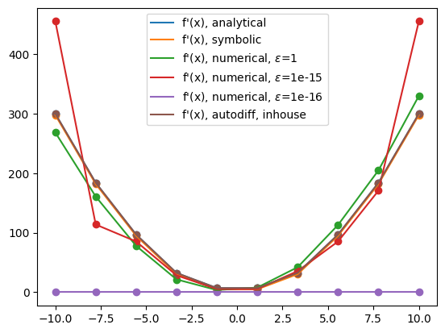
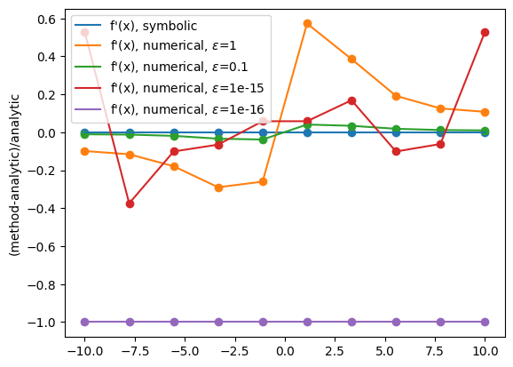
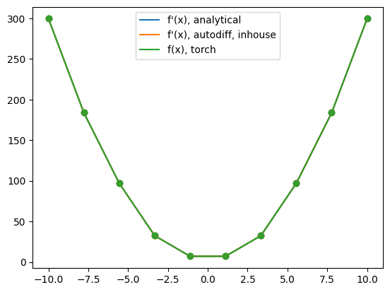
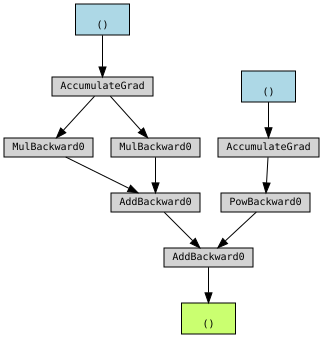
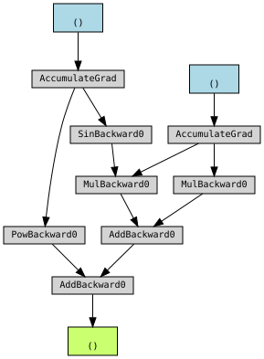

<div align="center">

# 📐 PA_01: Autodiff: cómo calcula derivadas un ordenador

### Comparando derivadas **analíticas, simbólicas, numéricas y automáticas**, e implementando *autodiff* desde cero con **números duales**

[](https://colab.research.google.com/github/DanielV-13/ADFM---PA_01_autodiff/blob/main/ADFM_PA_01_autodiff.ipynb)


**Análisis de Datos en Física Moderna (ADFM)**, Universidad de Oviedo · 2026

</div>

---

## 📑 Tabla de contenidos

1. [Sobre el proyecto](#-sobre-el-proyecto)
2. [¿Por qué importan las derivadas?](#-por-qué-importan-las-derivadas)
3. [Los 4 métodos de derivación](#-los-4-métodos-de-derivación)
4. [El camino del cuaderno](#%EF%B8%8F-el-camino-del-cuaderno)
5. [Autodiff desde cero: números duales](#-autodiff-desde-cero-números-duales)
6. [Resultados](#-resultados)
7. [PyTorch: modo inverso y trampas comunes](#-pytorch-modo-inverso-y-trampas-comunes)
8. [Lo que aprendí](#-lo-que-aprendí)
9. [Cómo ejecutarlo](#%EF%B8%8F-cómo-ejecutarlo)
10. [Créditos](#-créditos)

---

## 📌 Sobre el proyecto

Este repositorio contiene mi versión **resuelta y comentada en español** de la práctica de aula *PA_01: Derivatives*, creada por el profesor **Pietro Vischia** para la asignatura ADFM.

Es la **primera práctica del curso** y la base de todo lo que viene después: antes de entrenar una red neuronal hay que entender **cómo un ordenador calcula derivadas**, porque eso es exactamente lo que hace el *backpropagation*.

### ✍️ ¿Qué añadí sobre el cuaderno original?

| Añadido | Descripción |
| :--- | :--- |
| 💬 **Comentarios línea por línea** | Todo el código está comentado en español, explicando qué hace cada instrucción y por qué. |
| ✅ **Ejercicios resueltos** | La clase `DualNumber` (suma, producto por escalar, producto de duales) y la función `dualsin`, implementadas a mano. |
| 📐 **Explicaciones matemáticas** | Números duales, serie de Taylor con $\epsilon^2 = 0$, y cómo cada operación reproduce una regla de derivación. |
| 📊 **Interpretación de los gráficos** | Error de truncamiento, cancelación catastrófica y el límite de precisión de máquina. |
| 🔥 **Notas sobre PyTorch** | Tensores, `requires_grad`, grafo computacional, el error silencioso de `math.sin` y la acumulación de gradientes. |
| ⚖️ **Forward vs. Reverse mode** | Por qué las redes neuronales usan el modo inverso (*backpropagation*). |

---

## 🎯 ¿Por qué importan las derivadas?

Entrenar un modelo de *machine learning* es **minimizar una función de pérdida**, y para minimizarla hay que saber hacia dónde "baja": eso lo dice el **gradiente**. Una red neuronal puede tener millones de parámetros, así que necesitamos calcular derivadas de forma **exacta, rápida y automática**.

En todo el cuaderno se usa la misma función de prueba:

$$f(x) = 2 + 3\sin(x) + x^3 \qquad\Rightarrow\qquad f'(x) = 3\cos(x) + 3x^2$$

---

## 🧮 Los 4 métodos de derivación

| Método | ¿Cómo funciona? | ✅ Ventaja | ❌ Problema |
| :--- | :--- | :--- | :--- |
| ✍️ **Analítico** | Derivamos a mano y programamos el resultado | Exacto | Hay que hacerlo a mano para cada función |
| 🔣 **Simbólico** (`sympy`) | El programa manipula la expresión algebraica | Exacto | Con funciones complejas, la expresión de la derivada "explota" de tamaño |
| 🔢 **Numérico** (diferencias finitas) | $\frac{f(x+\epsilon)-f(x)}{\epsilon}$ | Sencillo, sirve para cualquier función | **Aproximado**: con $\epsilon$ grande hay error de truncamiento y con $\epsilon$ muy pequeño, error de redondeo |
| 🤖 **Automático** (*autodiff*) | Aplica la regla de la cadena operación por operación | **Exacto y eficiente** | Hay que usar funciones que el sistema sepa derivar |

---

## 🗺️ El camino del cuaderno

| # | Etapa | ¿Qué se hace? |
| :---: | :--- | :--- |
| 1 | 📈 **Función y derivada analítica** | Definimos $f(x)$ y la graficamos; vemos por qué `math` no trabaja con vectores y `numpy` sí. |
| 2 | 🔣 **Derivada simbólica** | `sympy` calcula la derivada exacta; vemos cómo "explota" con una función complicada. |
| 3 | 🔢 **Derivada numérica** | Diferencias finitas con distintos $\epsilon$ ($1$, $0.1$, $10^{-15}$, $10^{-16}$) y su error relativo. |
| 4 | 🤖 **Autodiff propio** | Creamos la clase `DualNumber` y sobrecargamos `+` y `*` para derivar automáticamente. |
| 5 | 🔥 **Autodiff con PyTorch** | `requires_grad`, `.backward()`, `.grad` y el grafo computacional con `torchviz`. |
| 6 | 🔀 **Varias variables** | Forward mode (una pasada por variable) vs. reverse mode (todas las derivadas en una pasada). |
| 7 | ⚠️ **Trampas de PyTorch** | `math.sin` rompe el grafo, y los gradientes se acumulan entre llamadas. |

---

## 🤖 Autodiff desde cero: números duales

Un **número dual** tiene la forma $a + b\epsilon$, con $\epsilon \neq 0$ pero $\epsilon^2 = 0$. Por la serie de Taylor:

$$f(a + b\epsilon) = f(a) + f'(a)\, b\,\epsilon$$

👉 La **parte primal** ($a$) lleva el valor de la función, y la **parte tangente** ($b$) lleva la derivada. **Ambas se calculan en una sola pasada.**

| Operación | Regla con números duales | Regla de derivación que reproduce |
| :--- | :--- | :--- |
| `__add__` | $(a+b\epsilon)+(c+d\epsilon) = (a+c)+(b+d)\epsilon$ | $(f+g)' = f'+g'$ |
| `__rmul__` | $k(a+b\epsilon) = ka + kb\,\epsilon$ | $(kf)' = kf'$ |
| `__mul__` | $(a+b\epsilon)(c+d\epsilon) = ac + (ad+bc)\epsilon$ | Regla del producto |
| `dualsin` | $\sin(a+b\epsilon) = \sin a + b\cos a\,\epsilon$ | Regla de la cadena |

> 💡 **La semilla:** para derivar respecto a $x$, el número dual de entrada debe crearse con `tangent = 1` ($dx/dx = 1$). Con `tangent = 0`, la derivada sale `0.0`.

---

## 📊 Resultados

### 1. Los métodos frente a frente

<div align="center">

</div>

Las derivadas **analítica, simbólica y autodiff** coinciden. La numérica con $\epsilon = 1$ se desvía (error de truncamiento), con $\epsilon = 10^{-15}$ da resultados erráticos y con $\epsilon = 10^{-16}$ vale **0** en todos los puntos.

### 2. El error relativo de la derivada numérica

<div align="center">

</div>

| $\epsilon$ | Comportamiento | Causa |
| :---: | :--- | :--- |
| $1$ | Error grande | **Truncamiento**: la secante está lejos de la tangente |
| $0.1$ | Error pequeño | Buena aproximación |
| $10^{-15}$ | Ruido errático | **Cancelación catastrófica**: al restar dos números casi iguales se pierden dígitos |
| $10^{-16}$ | Error fijo en $-1$ | **Límite de precisión** de `float64`: el ordenador ve $x + \epsilon = x$, así que la derivada da $0$ |

> 🎯 **Lección:** la derivada numérica tiene un $\epsilon$ "óptimo" y nunca es exacta. La simbólica y la autodiff tienen error **cero**.

### 3. Mi autodiff vs. PyTorch

<div align="center">

</div>

Mi implementación con números duales y la de PyTorch dan **exactamente** la derivada analítica. En $x = 1$: $f(1) = 5.5244$ y $f'(1) = 6.6209$ con los tres métodos.

### 4. Funciones de varias variables

Con $f(x_0, x_1) = 2x_0 + x_0\sin(x_1) + x_1^3$ en $(1, 2)$:

| Resultado | Números duales (forward) | PyTorch (reverse) |
| :--- | :---: | :---: |
| $f(1,2)$ | 10.9093 | 10.9093 |
| $\partial f / \partial x_0$ | 2.9093 *(1.ª pasada)* | 2.9093 |
| $\partial f / \partial x_1$ | 11.5839 *(2.ª pasada)* | 11.5839 |
| **Pasadas necesarias** | **1 por cada variable** | **1 para todas** |

> 🧠 Por eso las redes neuronales, que tienen millones de entradas y **una sola** salida (la pérdida), usan el **modo inverso**: es el *backpropagation*.

---

## 🔥 PyTorch: modo inverso y trampas comunes

### ⚠️ Trampa 1: `math.sin` rompe el grafo **sin avisar**

| Código | Grafo computacional | `x1.grad` |
| :--- | :--- | :---: |
| `x0*math.sin(x1)` | No aparece `SinBackward`: el seno se trata como constante | ❌ `12.0` |
| `x0*torch.sin(x1)` | Aparece `SinBackward0` | ✅ `11.5839` |

<div align="center">
<table>
<tr>
<td align="center"><b>❌ Con <code>math.sin</code></b></td>
<td align="center"><b>✅ Con <code>torch.sin</code></b></td>
</tr>
<tr>
<td></td>
<td></td>
</tr>
</table>
</div>

> **Regla de oro:** con tensores que tienen `requires_grad=True`, usa **siempre** funciones de `torch` (`torch.sin`, `torch.exp`, `torch.log`…), nunca `math.*` ni `np.*`.

### ⚠️ Trampa 2: los gradientes se **acumulan**

Cada `.backward()` **suma** al `.grad` existente. Al recrear la función sin limpiar los tensores, los gradientes se duplicaron: `5.8186` y `23.1677`, es decir **2×** el valor correcto. Hay que recrear los tensores o usar `.grad.zero_()`.

> Este diseño es intencional: permite **acumular gradientes en minibatches** al entrenar redes neuronales.

---

## 📚 Lo que aprendí

- 🧮 Hay **4 formas** de derivar en un ordenador, y solo la **simbólica** y la **automática** son exactas.
- 🔢 La derivada numérica falla en ambos extremos: con $\epsilon$ grande por **truncamiento** y con $\epsilon$ diminuto por **precisión de máquina**.
- 🤖 La **autodiff** no es magia: es la **regla de la cadena** aplicada operación por operación, y se puede implementar en pocas líneas con **números duales** y **sobrecarga de operadores**.
- 🌱 La derivada necesita una **semilla**: `tangent = 1`, es decir $dx/dx = 1$.
- 🔀 **Forward mode** necesita una pasada por variable y **reverse mode** una sola. Por eso las redes neuronales usan *backpropagation*.
- 🔥 En PyTorch, `requires_grad=True` activa el **grafo computacional (lista de Wengert)** y `.backward()` lo recorre al revés.
- ⚠️ Usar `math.sin` en vez de `torch.sin` produce gradientes **incorrectos sin ningún aviso**.
- ➕ Los gradientes **se acumulan** entre llamadas a `.backward()`.

---

## ▶️ Cómo ejecutarlo

### Opción 1: Google Colab (recomendada)
Haz clic en [](https://colab.research.google.com/github/DanielV-13/ADFM---PA_01_autodiff/blob/main/ADFM_PA_01_autodiff.ipynb) y ejecuta **Runtime → Run all**.

### Opción 2: Local
```bash
git clone https://github.com/DanielV-13/ADFM---PA_01_autodiff.git
cd ADFM---PA_01_autodiff
pip install numpy matplotlib sympy torch torchviz jupyter
jupyter notebook ADFM_PA_01_autodiff.ipynb
```

> ℹ️ Algunas celdas **fallan a propósito** (por ejemplo, `math.sin` con un vector de NumPy, o `.backward()` sin `requires_grad`). Forman parte del aprendizaje: la celda siguiente explica el error y lo corrige. Para dibujar los grafos con `torchviz` también se necesita **Graphviz** instalado en el sistema.

---

## 📁 Estructura del repositorio

```
ADFM---PA_01_autodiff/
├── ADFM_PA_01_autodiff.ipynb   # Cuaderno completo y comentado
├── img/                        # Gráficos y grafos computacionales extraídos del cuaderno
└── README.md                   # Este archivo
```

---

## 🙏 Créditos

| | |
| :--- | :--- |
| 📘 **Cuaderno original** | *Derivatives* © **Pietro Vischia**, 2025 |
| ✍️ **Resolución y comentarios** | © **Daniel Vaca Velastegui**, 2026 |
| 🤖 **Asistencia** | **Gemini Flash** (Google) y **Claude Opus 5.5** (Anthropic) |
| 📄 **Referencia** | Güneş Baydin et al. (2018), [*Automatic Differentiation in Machine Learning: a Survey*](https://jmlr.org/papers/v18/17-468.html), JMLR 18, 1–43 |

---

<div align="center">

**Daniel Vaca Velastegui** · Estudiante de intercambio en la Universidad de Oviedo · ADFM 2026

*Siguiente práctica:* [PA_02: Neural network from scratch](https://github.com/DanielV-13/ADFM---PA_02_neural_network_from_scratch) 🧠

</div>
